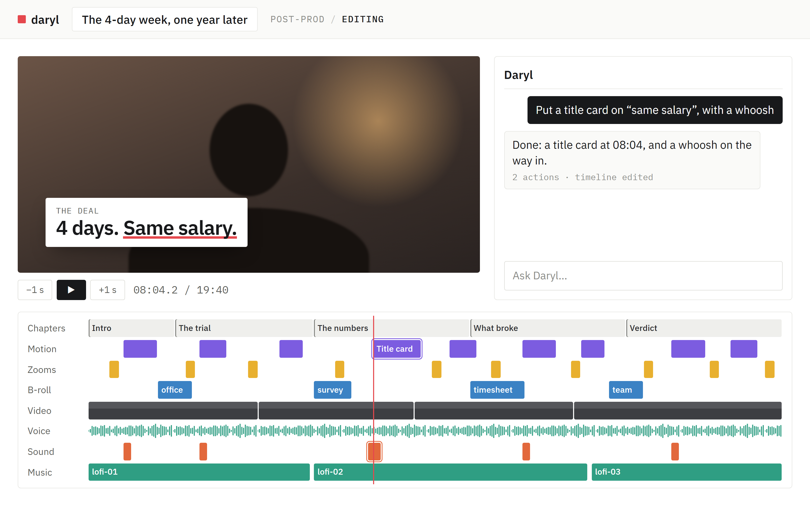
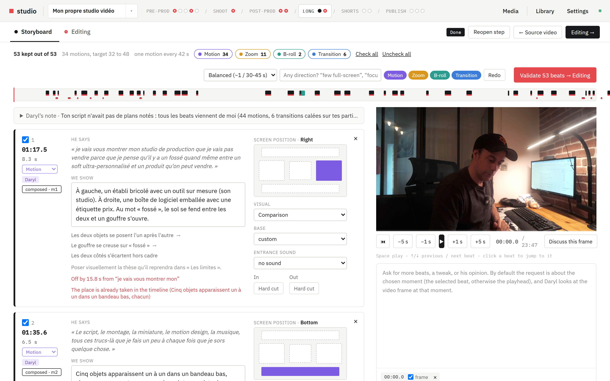

<p align="center">
  
</p>

<h1 align="center">Daryl</h1>

<p align="center">
  A local studio to make YouTube videos, from the idea to the upload,<br>
  with Claude Code as a co-author and editing assistant.
</p>

<p align="center">
  <a href="https://daryl.eventuallymaking.io">Website</a> ·
  <a href="https://rickub.com/hlassiege/daryl">Source code</a>
</p>

<p align="center">
  
</p>

---

Daryl takes a video through every step in one interface: angle, titles, thumbnails, script, shooting,
rough cut, storyboard, editing, shorts, render and upload. Daryl is also the name of the assistant
inside: it runs on your Claude Code subscription, proposes, and you decide.

A lot runs on your machine (Whisper, ffmpeg, HyperFrames), and you can plug in other services
(ElevenLabs or Gladia for transcription, fal.ai for thumbnails). The interface is available in English
and French, and Daryl writes in the language of your channel.

> **This is a fork.** haprod is based on [Daryl](https://rickub.com/hlassiege/daryl) by Hugo Lassiège
> (AGPL-3.0) and stays under the same license. Changes so far: macOS support (native dialogs, Finder,
> Keychain, fonts, Chrome lookup, Whisper on the Apple GPU) and two dependency fixes (`httpx`, `av<19`).

## A personal tool, shared as is

I use Daryl every week for [my own channel](https://www.youtube.com/@EventuallyCoding). I'm releasing it
as open source, but it remains a **personal tool**, maintained on a best-effort basis:

- You're welcome to use it, contribute to it, or fork it.
- It is licensed under the **AGPL-3.0** (see [License](#license)): if you modify it and offer it to
  others, including as a hosted service (SaaS), you must publish your full source code under the
  same license. It can't be turned into a closed commercial product.
- It will evolve in the direction **I** need. Feature requests may not land, but the code is fairly
  flexible overall, and it may give you ideas for your own workflow.

It is built on **Windows** and for a single user: no accounts, no remote server, all state lives in
`data/`. It may work on macOS and Linux, but I don't test it there.

## Projects

Everything starts from a **project**. Its folder (`data/projects/<id>/`) keeps everything it
produces, and `project.json` its state. The steps, grouped into Pre-production, Shoot,
Post-production (Long-form and Shorts) and Publishing:

| Step | What it does |
| --- | --- |
| Angle | From a brief (idea, direction, links, notes, length), Daryl researches the topic and suggests angles |
| Title | Daryl writes 30 titles from the chosen angle; you keep 2 or 3 for the A/B test |
| Thumbnail | One variant per kept title, generated with [fal.ai](https://fal.ai) from your references, or imported |
| Script | Write it yourself or let Daryl draft it from the angle, with versions and an assistant on the side |
| Roasting | Daryl reviews the script: score, verdict, estimated retention and remarks to fix |
| Shoot | Shots, shooting setups and a teleprompter for your phone |
| Rough cut | Import your footage: it is transcribed, silences and bad takes are cut. Export to DaVinci, Premiere or `.mp4` |
| Source video | The video to edit (the rough cut or a reworked import) and its transcript |
| Storyboard | Daryl reads the transcript and plans the motion design beats, anchored on the words; you review each one |
| Editing | Timeline with zooms, B-roll, motion design, on-screen text, sound design, music and chapters, by hand or with Daryl. FCPXML export |
| Clips | Daryl suggests passages to turn into shorts |
| Editing (Shorts) | Captions and animated slides for each short |
| Render | Renders the long-form video and the shorts |
| Details | Title, description, tags, chapters and A/B test for each video |
| Upload | Uploads each video to YouTube once its checks pass |

Motion design is HTML animated with GSAP, rendered with [HyperFrames](https://github.com/heygen-com/hyperframes).
A **Library** (`data/library/`) keeps your own resources (images, videos, sounds, templates) to reuse
across projects.

<p align="center">
  
</p>

### Claude Code skills for editing

Some editing jobs are done from a Claude Code session opened in this repository, with skills in
`.claude/skills/`:

| Skill | What it does |
| --- | --- |
| `music-bed` | Scores the edit with background music from [Epidemic Sound](https://www.epidemicsound.com): one track per sequence, cut to cover it and ducked under the voice |
| `replace-aroll-take` | Replaces a stretch of the A-roll with a re-recorded take, and moves the B-roll, motions, sounds and zooms onto the new delivery |
| `snatch-cut` | Proposes a burst of close-ups with snap zooms and punchy sound design, with a preview render |

`music-bed` needs an Epidemic Sound subscription and its MCP server (`.mcp.json`, with your key in
`EPIDEMIC_SOUND_API_KEY`). The `hyperframes-*`, `gsap`, `three` and `motion-graphics` skills come from
HyperFrames (see [Third-party notices](THIRD_PARTY_NOTICES.md)).

## Versions

Each version is a git tag (`v0.2.0`…), described in the [changelog](CHANGELOG.md). To get a given version:

```bash
git clone --branch v0.2.0 --depth 1 https://github.com/lwilly3/haprod.git
```

or, in an existing clone, `git fetch --tags && git checkout v0.2.0`. A release is one commit
(`chore(release): vX.Y.Z`) that bumps `web/package.json` and the changelog, then the tag of the same name.

## Requirements

- **Windows** or **macOS** (native file dialogs, keys read from the Windows user environment or the macOS Keychain)
- **Python 3.12**
- **Node.js** and **pnpm**
- **ffmpeg** in the PATH (`winget install ffmpeg`; on macOS `brew install ffmpeg-full`: the plain `ffmpeg`
  formula has no `drawtext` filter, which the on-screen texts of the edit need)
- **[Claude Code](https://claude.com/claude-code)** installed and logged in (`claude auth login`). Other
  LLMs are not supported.
- Optional: an NVIDIA GPU for Whisper (otherwise it runs on the CPU, slower)
- Optional: an [ElevenLabs](https://elevenlabs.io) or [Gladia](https://www.gladia.io) key for cloud transcription
- Optional: a [fal.ai](https://fal.ai) key to generate thumbnails
- Optional: an [Epidemic Sound](https://www.epidemicsound.com) subscription for the `music-bed` skill
- Optional: a [ytwatch](https://ytwatch.hakanai.io) account for channel stats

## Installation

```powershell
git clone https://rickub.com/hlassiege/daryl.git
cd daryl
py -3.12 -m venv .venv
.venv\Scripts\pip install -r backend\requirements.txt
cd web; pnpm install
```

On macOS:

```bash
git clone https://github.com/lwilly3/haprod.git
cd haprod
python3.12 -m venv .venv
.venv/bin/pip install -r backend/requirements.txt
cd web && pnpm install        # or: npx pnpm install
cd ../backend && ../.venv/bin/python -m studio
```

On Apple Silicon, Whisper runs on the GPU through [mlx-whisper](https://github.com/ml-explore/mlx-examples/tree/main/whisper)
(`TRANSCRIPT_DEVICE=cpu` goes back to faster-whisper on the CPU). The model (about 1.6 GB) is downloaded
on the first transcription.
Video is encoded by the Mac's hardware encoder (VideoToolbox); `STUDIO_ENCODER=x264` goes back to libx264.
The fal.ai key goes in the Keychain:
`security add-generic-password -U -s FAL_KEY -a "$USER" -w "your-key"`.

`backend/requirements.txt` installs the CUDA DLLs for Whisper; on a machine without an NVIDIA GPU,
you can remove the `nvidia-*` lines.

## Running

From `backend/`:

```powershell
..\.venv\Scripts\python -m studio dev   # development: hot reload everywhere
..\.venv\Scripts\python -m studio       # normal use: built interface (run pnpm build in web/ first)
```

Then open http://localhost:4400.

Final rendering goes through the [HyperFrames](https://www.npmjs.com/package/hyperframes) CLI, run
with `npx` (downloaded on first render, along with its Chrome).

## External services

**You are responsible for complying with the terms of service of every service this tool uses**
(YouTube, Anthropic / Claude, fal.ai, ElevenLabs, Gladia, Epidemic Sound, ytwatch, and the websites
you download content from).

**Claude Code.** The writing and editing steps run Claude Code headless (`claude -p`): it uses your
logged-in subscription, not the API. `ANTHROPIC_API_KEY` is removed from its environment to avoid
switching to API billing. Each session is isolated (no user `CLAUDE.md`, hooks or MCP) and follows
the skills in the `skills/` folder, copied into each project.

**Transcription.** Whisper runs locally by default. In Settings → Services, paste an ElevenLabs or
Gladia key to transcribe in the cloud instead.

**fal.ai.** The Thumbnail step generates its images with fal.ai: you need a key (fal.ai → API Keys)
in `FAL_KEY`. A `setx FAL_KEY "your-key"` is enough: Daryl reads it again from the Windows user
environment, no restart needed. Each image is billed by fal.

**ytwatch.** In Settings, channel stats come from the [ytwatch](https://ytwatch.hakanai.io)
MCP, with a token pasted into the app (stored in `data/ytwatch.json`). Daryl uses it to analyze
the channel. Everything else works without it.

## Publishing to YouTube

The Upload step uses the YouTube Data API v3, with your own OAuth client:

1. On [console.cloud.google.com](https://console.cloud.google.com), create a project, then enable
   "YouTube Data API v3" (APIs & Services → Library).
2. OAuth consent screen: "External" type, add your address to the test users.
3. Credentials → Create → OAuth client ID → "Desktop app"; download the JSON.
4. In Daryl, Settings → Services → YouTube account: drop this file, then "Connect YouTube" (the consent screen opens
   in the browser).

API limits: until Google has audited the project, uploaded videos stay private (switch them to
public in YouTube Studio); an upload costs 1,600 units of the 10,000 daily quota (about 6 videos);
A/B test variants B and C are set in YouTube Studio.
The client and the token are stored in `data/youtube/`.

## Teleprompter on your phone

The interface also listens on the local network: `https://<pc-name>.local:4400/prompteur`. In `dev`,
Vite switches to HTTPS if it finds a certificate in `web/.certs/` (ignored by git): the phone
requires it to keep the screen on. To create it (once):

```powershell
winget install FiloSottile.mkcert
mkcert -install
cd web; mkdir .certs
mkcert -cert-file .certs\cert.pem -key-file .certs\key.pem <pc-name>.local <pc-ip> localhost 127.0.0.1
copy "$(mkcert -CAROOT)\rootCA.pem" .certs\rootCA.crt
```

On iPhone: open `https://<pc-name>.local:4400/rootCA.crt`, install the profile (Settings → Profile
Downloaded), then trust it (Settings → General → About → Certificate Trust Settings). The Windows
firewall must allow port 4400 on the private network.

## Architecture

```
backend/studio/
  __main__.py        launcher (dev / start / api / worker)
  app.py             FastAPI API: mounts /api/<module>
  core/
    claude.py        headless Claude Code (claude -p), shared by modules
    fal.py           fal.ai (image models): HTTP queue, FAL_KEY
    jobs.py          SQLite job queue, shared API ↔ worker
    worker.py        runs jobs; keeps models in memory
    tasks.py         Task / TaskContext (progress, cancellation)
    system.py        ffmpeg, Windows dialogs
    youtube_api.py   YouTube account (OAuth) for publishing
  modules/
    transcript/      api.py · tasks.py · whisper.py · cloud.py (ElevenLabs, Gladia) · cues.py · service.py
    youtube/         api.py · tasks.py · service.py
    animations/      api.py · tasks.py · service.py · captions.py (captions) · render.py (HyperFrames) · kit/
    shorts/          api.py · tasks.py · service.py · render.py
    settings/        api.py · service.py (channel, services, ytwatch) · analysis.py (channel analysis by Claude)
    projects/        api.py · service.py (project.json) · runtime.py (jobs, imports, source video)
                     derush.py / autoderush.py (rough cut, Daryl's cuts, .xml)
                     prompts.py / tasks.py (Claude, copies, render)
                     library.py (resources, library) · migrate.py (migration of older data)
                     script.py (block-based script) · roast.py (Roasting step: runs, remarks)
                     thumbs.py / thumb_tasks.py (Thumbnail step)
                     assets.py / asset_tasks.py / media.py (adding media: downloads, images, screenshots)
                     storyboard.py / storyboard_chat.py (motion design beats)
                     montage.py / montage_tasks.py / timeline.py / transitions.py (editing, motions, FCPXML)
                     render.py (final render of the long-form video, ffmpeg)
                     publish.py (Details and Upload: metadata, checks, YouTube upload)
                     cleanup.py (unused files of a project)
web/                 Vue 3 + Vite
  src/pages/         home, new project / brief, library, settings, teleprompter
  src/project/       open project store, top bar, step header, steps/ (one screen per step)
  scripts/           screenshots.mjs (the images of this README and the share image of the website)
skills/              Claude skills copied into each project (script, titles, thumbnail)
.claude/skills/      Claude Code skills for editing sessions in this repository
site/                the website (static, deployed to Bunny CDN)
data/                SQLite database, projects, library, media (ignored by git)
```

Three processes in dev:

- **Vite** (port 4400): the interface, with HMR. It proxies `/api` to the API.
- **API** (port 4401): lightweight, restarts on every `.py` change. No model is loaded there.
- **Worker**: runs jobs and keeps Whisper in GPU memory. It only restarts when its own code changes (not for an `api.py`); interrupted jobs then start over.

All state goes through `data/studio.db`: restarting the API or the worker loses nothing.

## Adding a module

1. `backend/studio/modules/<name>/api.py` with a `router`, and `tasks.py` with `TASKS = {"kind": Task(queue=..., run=...)}`.
   Heavy imports (models, ML libs) go in `tasks.py`: only the worker loads it.
2. Add `<name>` to `MODULES` in `backend/studio/modules/__init__.py`.
3. On the interface side: a page in `web/src/pages/` declared in `web/src/router.ts`, or a step in `web/src/project/steps/`.

Tasks on the same `queue` run one at a time (e.g. `gpu`); two different queues run in parallel.

## Environment variables

| Variable | Default |
| --- | --- |
| `STUDIO_PORT` / `STUDIO_API_PORT` | 4400 / 4401 |
| `STUDIO_DATA_DIR` | `data` |
| `TRANSCRIPT_OUTPUT_DIR` | `data/transcripts` (files dropped in the browser) |
| `TRANSCRIPT_MODEL` / `TRANSCRIPT_DEVICE` | `large-v3-turbo` / `auto` |
| `YOUTUBE_OUTPUT_DIR` | `data/downloads` |
| `SCRIPTS_SKILL_DIR` | `skills/youtube-scriptwriting` |
| `TITLES_SKILL_DIR` | `skills/youtube-titles` |
| `THUMB_SKILL_DIR` | `skills/youtube-thumbnail` |
| `FAL_KEY` | fal.ai key (also read from the Windows user variables) |
| `EPIDEMIC_SOUND_API_KEY` | Epidemic Sound key, for the `music-bed` skill (`.mcp.json`) |
| `STUDIO_NO_BROWSER` | unset (set it to `1` to not open the browser on launch) |

## Website and images

The screens shown on the website are mockups: the app's screens redrawn in HTML and CSS
(`site/public/index.html`), in English, on a made-up project, and animated. The images in
`media/screenshots/` (this README, and the share image of the website) are captured from these mockups:

```powershell
cd web; pnpm screenshots
```

The website lives in `site/`. `node site/serve.mjs` serves it on http://localhost:4477 while you work on it
(reload the page after an edit); `node site/build.mjs` builds it into `site/dist/`. It is deployed to
Bunny CDN by `.rickub/workflows/deploy-site.yml` when `site/`, the images or the logo change.

## Contributing

The source of truth is [rickub.com/hlassiege/daryl](https://rickub.com/hlassiege/daryl); the
[GitHub repository](https://github.com/hlassiege/daryl) is a read-only mirror.

Issues and pull requests are welcome on rickub, keeping in mind this is a personal tool (see above):
I'll merge what fits how I work. For a bigger change, open an issue first. By submitting a
contribution, you agree that it is licensed under the AGPL-3.0 and that the maintainer may also
distribute it under other license terms.

## More from the author

- [panoplie](https://panoplie.eventuallymaking.io): one catalog for the skills, rules and MCP servers of your coding agents.
- [Bloggrify](https://bloggrify.com): open source static blog generator built on Nuxt and Nuxt Content.
- [hakanai.io](https://hakanai.io): comments, analytics and newsletter for static blogs.
- [Writizzy](https://writizzy.com): blogging and newsletter platform.
- [Kula](https://kulamail.com): transactional and marketing email for developers and agents.

All projects are listed on [eventuallymaking.io](https://eventuallymaking.io/p/about-me).

## License

Copyright © 2026 Hugo Lassiège

Licensed under the [GNU Affero General Public License v3.0](LICENSE) (AGPL-3.0-only). For any other
licensing terms, contact me.

Third-party skills and components keep their own licenses: see [THIRD_PARTY_NOTICES.md](THIRD_PARTY_NOTICES.md).
